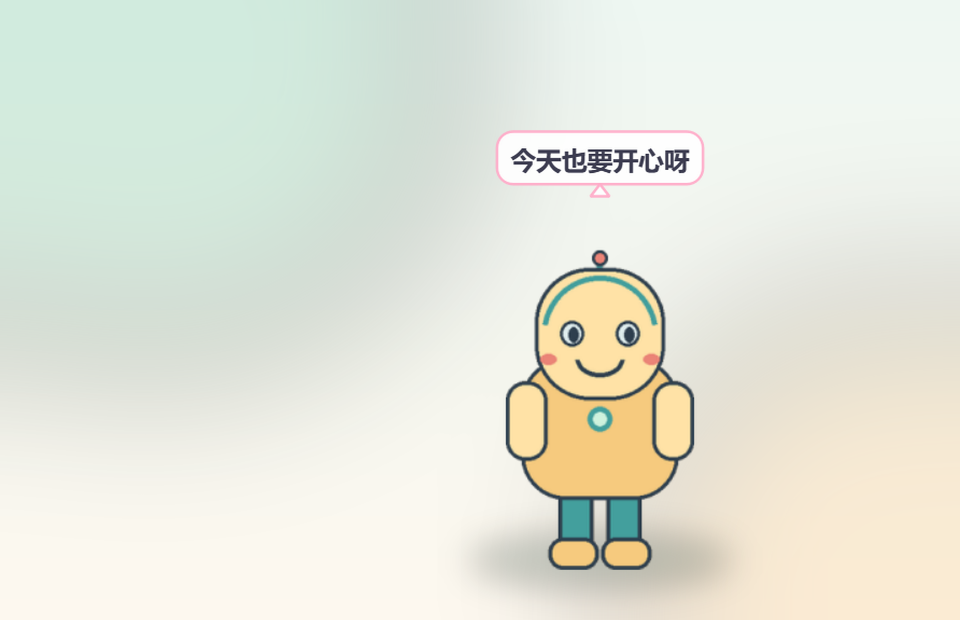
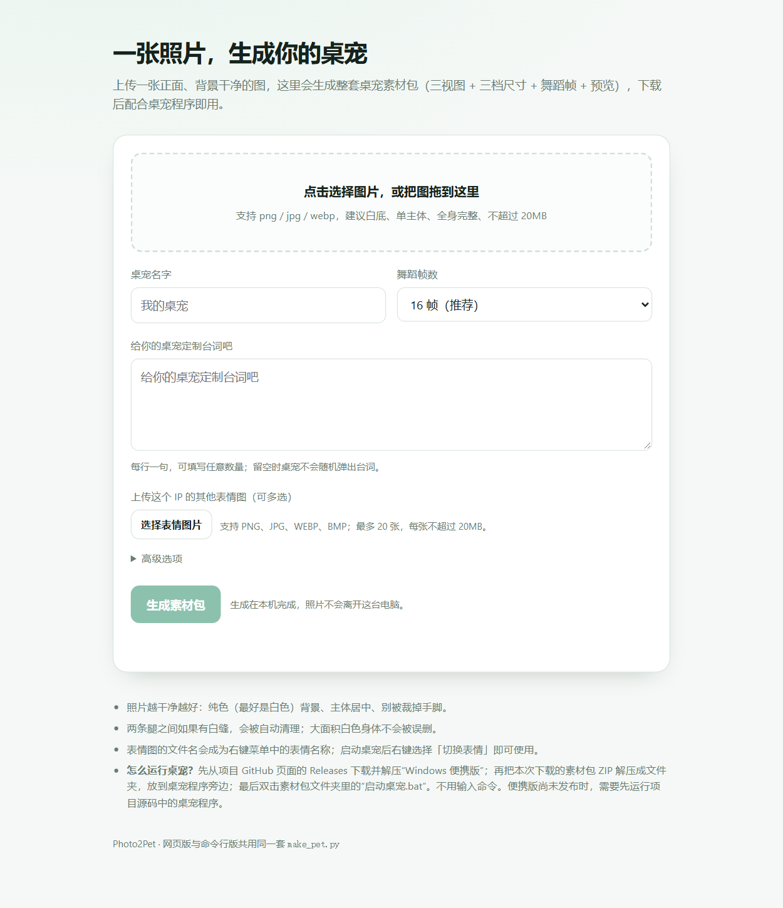

# Photo2Pet

**一张角色图片，生成一只可以在 Windows 桌面上活动的小桌宠。**

Photo2Pet 是一个完全本地运行的 Windows 桌宠工具。上传一张正面图，它会自动生成三视图、三档尺寸、舞蹈帧和表情位；生成后，角色会出现在透明桌面窗口里。不需要账号、API Key，也不需要联网。

<p align="center">
  
</p>
<p align="center"><sub>内置示例桌宠；透明窗口背景仅为展示效果</sub></p>

## 能做什么

- **一张图生成整套素材**：自动抠图，生成正面/侧面/背面、三档尺寸、舞蹈动画帧和预览图。
- **按你的想法定制**：自定义名字、任意数量台词和多张表情图；桌宠右键菜单可切换表情。
- **桌面互动**：散步、拖拽、蹦跳、跳舞、喂食、切换大小、鼠标穿透、开机自启。
- **本地优先**：照片和表情只在本机处理，桌宠运行不需要联网。
- **开箱即用**：仓库自带原创示例吉祥物和 8 张表情，不依赖特定影视、游戏或网络 IP。

## 快速开始

### Windows 便携版（推荐，不需要安装 Python）

从[最新 Release](https://github.com/JiaqiChen-tju/Photo2Pet/releases/latest)下载 `Photo2Pet-portable.zip` 和旁边的 `.sha256` 校验文件。

1. 将 ZIP 解压到桌面、文档等可写入的文件夹。
2. 双击 `Photo2Pet-Generator.exe`，网页会自动打开；上传正面角色图，可选填写名字、台词和表情。
3. 生成后先查看桌宠正面和舞蹈预览，再点击「下载素材包」。
4. 将素材包 ZIP 解压到 `Photo2Pet.exe` 旁边，双击素材包文件夹里的 `启动桌宠.bat`。
5. 只想体验内置示例时，直接双击 `Photo2Pet.exe`。

生成过程在本机完成，不需要账号、API Key 或联网。首次启动可能需要几秒。如果 Windows SmartScreen 或杀毒软件提示风险，请先确认文件来自本项目 Release，并核对 SHA-256 校验文件；不要盲目忽略安全提示。建议不要把程序放在 `C:\Program Files` 等受保护目录。

### 从源码运行（Windows 10/11）

需要 Python 3.12。下载或克隆源码后，在项目文件夹打开 PowerShell：

```powershell
py -3.12 -m venv .venv
.\.venv\Scripts\python.exe -m pip install --upgrade pip
.\.venv\Scripts\python.exe -m pip install -r requirements.txt
```

启动素材生成网页：

```powershell
.\.venv\Scripts\python.exe web\app.py
```

浏览器会自动打开 <http://127.0.0.1:8000>。也可以直接运行内置示例桌宠：

```powershell
.\.venv\Scripts\python.exe 桌宠.py
```

或者双击 `启动桌宠.bat`（首次使用前仍需完成上面的依赖安装）。

## 用自己的照片生成桌宠



1. 上传一张正面、背景干净的图片。白底或透明背景效果最好。
2. 填写桌宠名字和台词；台词每行一句，留空则不会随机说话。
3. 可选：上传多张表情图，文件名会显示在桌宠的「切换表情」菜单里。
4. 点击「生成素材包」，检查生成后的正面与舞蹈预览。
5. 点击下载并解压 ZIP，把素材包文件夹放到桌宠程序旁边，双击 `启动桌宠.bat`。

从源码运行时，也可以直接指定素材包：

```powershell
.\.venv\Scripts\python.exe 桌宠.py --assets "素材包文件夹的完整路径"
```

不想用浏览器时，也可以用命令行生成素材包（台词和表情请通过网页设置，或生成后直接编辑 `config.json`）：

```powershell
.\.venv\Scripts\python.exe make_pet.py --photo "角色图片.png" --name "我的桌宠" --out "我的桌宠素材包"
```

照片要求和抠图选项详见[照片准备指南](docs/photo-guide.md)；素材包结构详见[素材包说明](docs/asset-pack.md)。

## 桌宠操作

| 操作 | 效果 |
|------|------|
| 左键单击 | 蹦跳并随机说一句台词 |
| 按住左键拖动 | 移动位置 |
| 双击 | 打开喂食面板 |
| 右键 | 模式、大小、切换表情、跳个舞、显示/隐藏、鼠标穿透、置顶、开机自启、退出 |
| 托盘图标右键 | 同一套菜单；开启鼠标穿透后从这里恢复 |

## 素材包里有什么

```text
素材包/
├── sprites/                 正面、侧面、背面与三档尺寸
├── assets/
│   ├── dance/               舞蹈帧
│   └── expressions/         上传的表情图片
├── config.json              桌宠名字、台词等设置
├── 启动桌宠.bat             找到旁边的桌宠程序并加载本素材包
├── preview.png              舞蹈帧拼图
└── sprite_preview.png       角色正面预览
```

## 项目结构

| 路径 | 内容 |
|------|------|
| `桌宠.py` | 桌面宠物程序 |
| `make_pet.py` | 照片 → 素材包的命令行工具 |
| `web/` | 本地网页版素材生成器 |
| `assets/`、`sprites/` | 内置示例素材 |
| `docs/` | 照片、素材包、网页版与开发文档 |
| `tools/` | 示例素材生成、预览渲染与打包脚本 |
| `tests/` | 单元测试 |

## 照片建议与已知限制

- 主体正面朝前、完整入镜、背景干净；白色或透明背景最容易处理。
- 侧面和背面由正面图近似生成，不是独立拍摄的真实视图；舞蹈是图片分区形变，不是骨骼动画。
- 复杂背景自动抠图需要额外安装可选依赖 `rembg` 和 `onnxruntime`；白底或透明图不需要。
- 请只上传你拥有或获授权使用的图片。素材包会包含生成的角色素材，分享或分发前请自行确认权利。
- 本地网页默认只监听 `127.0.0.1`，不要把它当作公网服务直接开放。

## 文档

- [照片准备与抠图指南](docs/photo-guide.md)
- [素材包结构与配置](docs/asset-pack.md)
- [网页版与 HTTP 接口](docs/web-app.md)
- [开发、测试与发版](docs/contributing.md)
- [使用说明](使用说明.txt)

## 开发与测试

```powershell
# 单元测试
.\.venv\Scripts\python.exe -m unittest discover -s tests -v

# 离屏自检
$env:QT_QPA_PLATFORM = "offscreen"
.\.venv\Scripts\python.exe 桌宠.py --smoke-test
```

打包 Windows 单文件 exe（需要先安装 `requirements-dev.txt`）：

```powershell
.\tools\build_exe.ps1
```

GitHub Actions 会在 Windows + Python 3.12 上运行测试和自检；维护流程见[开发指南](docs/contributing.md)。

## 许可

Photo2Pet 代码和仓库内由项目脚本绘制的示例素材以 MIT License 发布，详见 [LICENSE](LICENSE) 和 [NOTICE](NOTICE)。项目在作者早期 MIT 许可的桌宠原型基础上继续开发；当前版本的单图素材管线、外部素材包、示例素材、文档与测试均为本项目新增。第三方依赖有各自的许可要求。
