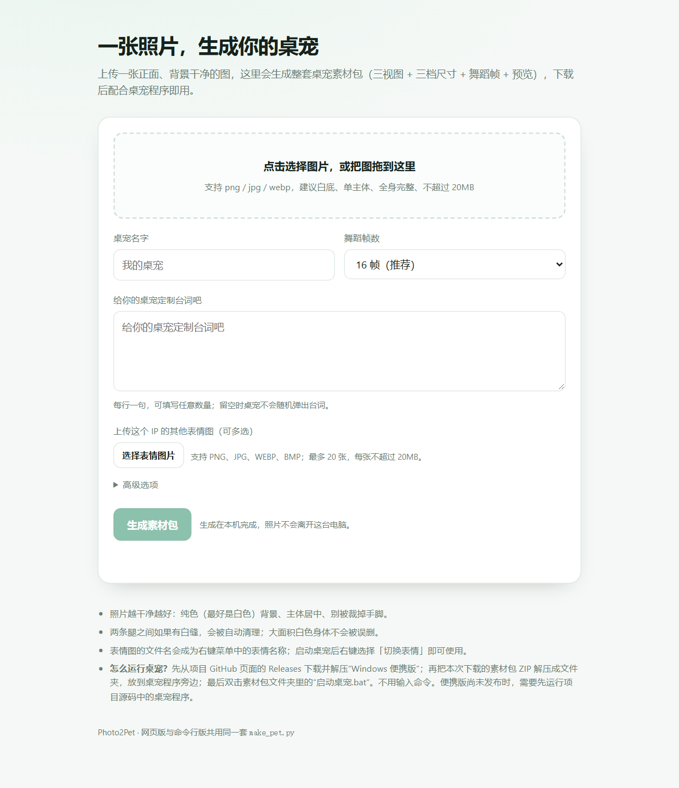
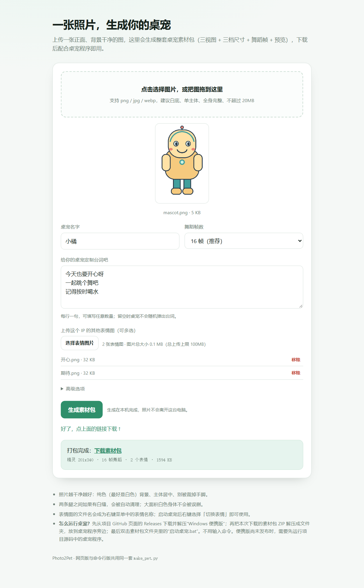

# 网页版：浏览器上传，下载素材包

不想敲命令行的话用它：双击 Release 中的 `Photo2Pet-Generator.exe`，浏览器会打开本机生成页面。生成后可先查看桌宠正面与舞蹈预览，再下载素材包；不需要安装 Python。

## 启动

```bash
python web/app.py                 # 默认 http://127.0.0.1:8000，自动开浏览器
python web/app.py --port 8123     # 端口被占时换一个
python web/app.py --no-browser    # 不自动开浏览器
```

只依赖 Python 标准库（`http.server` + `zipfile`）和你已经装好的 Pillow，**不需要 Flask**。



生成后会在页面内展示桌宠正面和舞蹈帧预览，点击下载按钮保存素材包：



## 页面上能填什么

| 项 | 作用 |
|----|------|
| 图片 | 拖拽或点选，支持 png / jpg / webp / bmp，上限 20MB |
| 桌宠名字 | 写进 `config.json` 的 `name`，也用作下载文件名 |
| 舞蹈帧数 | 8 / 12 / 16 / 24，默认 16 |
| 定制台词 | 每行一句，数量不限；桌宠左键单击时随机显示。留空时不显示随机台词 |
| 表情图片 | 可多选 PNG / JPG / WEBP / BMP，最多 20 张、单张不超过 20MB；文件名会显示为桌宠右键菜单的表情名称 |
| 抠图方式 | 自动 / 强制白底 / 图本身已透明 |
| 眼睛坐标 | 可选，填写左眼和右眼中心的位置 `x1,y1,x2,y2` 可启用眨眼；从角色图左上角计像素，X 向右、Y 向下。先生成素材包后可查看 `sprite_preview.png`，图片高 340 像素；例如 `70,120,130,120`。不确定时留空 |

下载文件名形如 `我的桌宠-素材包.zip`。素材包里附有 `启动桌宠.bat`：将素材包解压到 Windows 便携版目录旁边，双击启动文件即可使用此形象。启动后右键桌宠并在「切换表情」菜单中选择已上传的表情。

## 它到底做了什么

服务端收到照片后写进 `.tmp/web/upload_*/`，调用 `make_pet.build(...)`（和命令行版是同一份代码），
把输出目录打包成 zip、读取预览图并删掉临时目录。压缩包暂存于本地进程内存中，下载链接 15 分钟后过期，最多保留 3 个结果。所以：

- **照片不出这台电脑**：服务只监听 `127.0.0.1`，不往外发任何请求。
- **不留垃圾**：每次请求结束都会清理 `.tmp/web` 下的工作目录。
- **生成结果和命令行完全一致**：同一个 `make_pet.py`，产出的目录结构见 [asset-pack.md](asset-pack.md)。

## HTTP 接口

想脚本化调用的话，直接用这个接口：

```
POST /api/build
Content-Type: multipart/form-data

photo   文件（必填）
expression_0、expression_1…  表情图片（可选，最多 20 张）
name    文本（可选）
lines   文本，每行一句（可选，不限行数）
frames  文本，4~32（可选，默认 16）
cutout  文本，auto|white|alpha（可选）
eyes    文本，x1,y1,x2,y2（可选）
```

响应 200 是 JSON，包含桌宠正面及舞蹈预览的 PNG data URL、素材尺寸/帧数/表情数、文件名和随机下载路径。浏览器后续 GET 下载路径会获得 ZIP；`Content-Disposition` 使用 RFC 5987 编码中文名。链接在 15 分钟后过期，最多暂存最近 3 个结果。

失败时返回 JSON：`{"ok": false, "error": "…"}`，常见的有 `400`（没收到照片 / 格式不支持）、
`413`（单张图片超过 20MB 或总上传超过 100MB）、`500`（生成过程报错，控制台会打印堆栈）。

还有一个 `GET /healthz`，返回 `{"ok": true}`，用来确认服务活着。`GET /api/download/<token>` 用来下载本次生成的素材包。

## 限制

- 一次一张图，没有批量队列；并发请求会串行排队（生成占 CPU）。
- 没有用户系统、没有账号：它是个**本机工具**，不是线上服务。
- 想放到公网得自己做鉴权、限流、超时清理，仓库里不提供这些。
